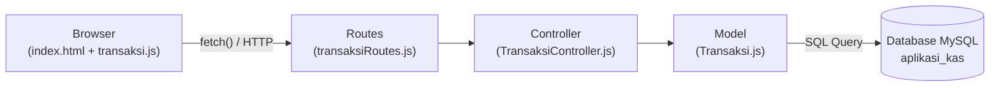
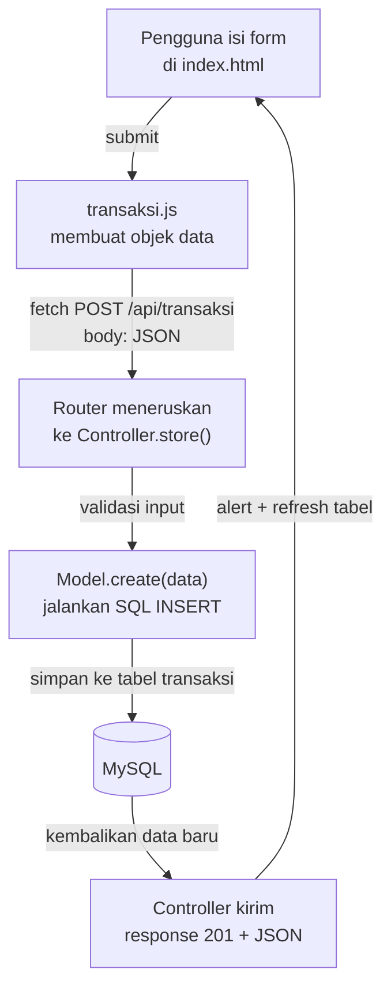
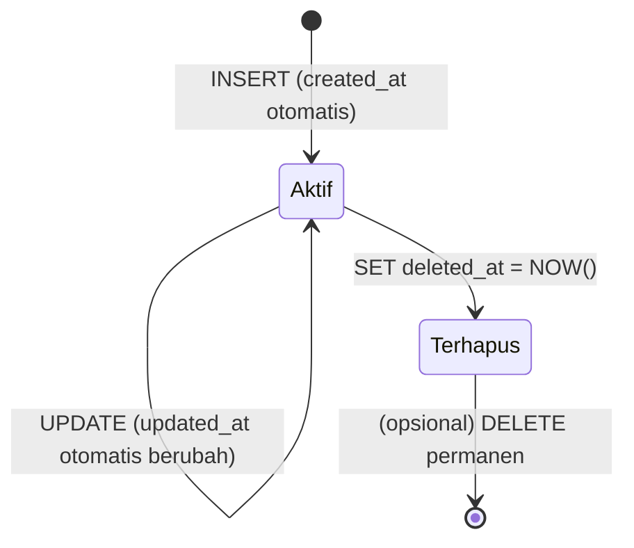
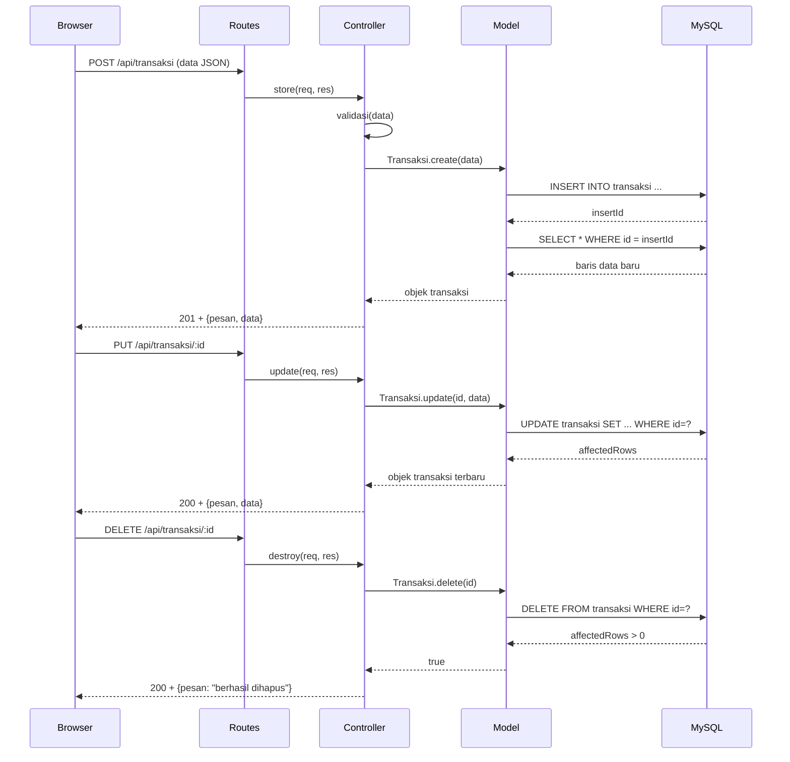

# 📚 Memahami Aplikasi Kas — Panduan Belajar

Aplikasi ini adalah web app sederhana berbasis **MVC (Model-View-Controller)** yang dibangun dengan **Node.js + Express + MySQL**.

---

## Arsitektur Singkat



| Lapisan | File | Tugasnya |
|---|---|---|
| **View** | `public/index.html` + `public/js/transaksi.js` | Tampilan & komunikasi ke server |
| **Route** | `routes/transaksiRoutes.js` | Peta URL → fungsi controller |
| **Controller** | `controllers/TransaksiController.js` | Logika bisnis & validasi |
| **Model** | `models/Transaksi.js` | Interaksi langsung ke database |
| **Config** | `config/database.js` | Koneksi ke MySQL |

---

## 1. Bagaimana Aplikasi Menyimpan Input Pengguna

Proses penyimpanan melewati **5 tahap**:



### Langkah demi Langkah

**① Form HTML mengumpulkan input** [`index.html` baris 25–61](file:///c:/Users/guest1/Documents/_GHR/belajar%20mvc/aplikasi-kas/public/index.html#L25-L61)

```html
<form id="formTransaksi">
  <input type="hidden" id="idTransaksi">   <!-- kosong = mode Simpan baru -->
  <input type="date"   id="tanggal" required>
  <input type="text"   id="keterangan" required>
  <select id="jenis">
    <option value="masuk">Pemasukan</option>
    <option value="keluar">Pengeluaran</option>
  </select>
  <input type="number" id="jumlah" min="1" required>
  <button type="submit" id="tombolSimpan">Simpan</button>
</form>
```

**② JavaScript membaca form & mengirim ke API** [`transaksi.js` baris 143–162](file:///c:/Users/guest1/Documents/_GHR/belajar%20mvc/aplikasi-kas/public/js/transaksi.js#L143-L162)

```js
const id   = document.getElementById("idTransaksi").value;  // ada isi = edit
const data = {
  tanggal:    document.getElementById("tanggal").value,
  keterangan: document.getElementById("keterangan").value,
  jenis:      document.getElementById("jenis").value,
  jumlah:     document.getElementById("jumlah").value
};

const response = await fetch(
  id ? `/api/transaksi/${id}` : `/api/transaksi`,
  {
    method:  id ? "PUT" : "POST",   // PUT = update, POST = baru
    headers: { "Content-Type": "application/json" },
    body:    JSON.stringify(data)   // ubah objek JS → teks JSON
  }
);
```

> [!NOTE]
> `fetch()` adalah cara browser mengirim data ke server tanpa me-reload halaman (teknik disebut **AJAX**). Data dikirim dalam format **JSON** di dalam *body* HTTP request.

**③ Controller memvalidasi lalu meneruskan ke Model** [`TransaksiController.js` baris 25–41](file:///c:/Users/guest1/Documents/_GHR/belajar%20mvc/aplikasi-kas/controllers/TransaksiController.js#L25-L41)

```js
static async store(req, res) {
  const { tanggal, keterangan, jenis, jumlah } = req.body; // ambil dari JSON

  if (!TransaksiController.validasi(req.body)) {
    return res.status(400).json({ pesan: "Data transaksi tidak valid" });
  }

  const data = await Transaksi.create({ tanggal, keterangan, jenis, jumlah });

  res.status(201).json({ pesan: "Transaksi berhasil disimpan", data });
}
```

**④ Model menjalankan SQL INSERT ke database** [`Transaksi.js` baris 23–37](file:///c:/Users/guest1/Documents/_GHR/belajar%20mvc/aplikasi-kas/models/Transaksi.js#L23-L37)

```js
static async create(data) {
  const [result] = await db.execute(
    `INSERT INTO transaksi (tanggal, keterangan, jenis, jumlah)
     VALUES (?, ?, ?, ?)`,
    [data.tanggal, data.keterangan, data.jenis, data.jumlah]
  );
  return this.getById(result.insertId);  // ambil data yang baru tersimpan
}
```

> [!TIP]
> Tanda `?` di SQL disebut **prepared statement / parameterized query** — cara aman untuk menyisipkan nilai dari pengguna agar terhindar dari serangan **SQL Injection**.

---

## 2. Bagaimana Program Membedakan Pemasukan dan Pengeluaran

Pembeda utamanya adalah kolom **`jenis`** di database, yang hanya boleh berisi dua nilai: `"masuk"` atau `"keluar"`.

### Validasi di Controller

[`TransaksiController.js` baris 95–113](file:///c:/Users/guest1/Documents/_GHR/belajar%20mvc/aplikasi-kas/controllers/TransaksiController.js#L95-L113)

```js
static validasi(data) {
  const { tanggal, keterangan, jenis, jumlah } = data;
  return (
    tanggalValid &&
    typeof keterangan === "string" && keterangan.trim().length > 0 &&
    ["masuk", "keluar"].includes(jenis) &&   // ← hanya dua nilai yang boleh
    Number.isFinite(Number(jumlah)) && Number(jumlah) > 0
  );
}
```

Baris `["masuk", "keluar"].includes(jenis)` memastikan nilai `jenis` **hanya bisa** salah satu dari dua pilihan itu. Nilai lain seperti `"income"` atau `"debit"` akan ditolak.

### Digunakan untuk Hitung Saldo

[`Transaksi.js` baris 75–89](file:///c:/Users/guest1/Documents/_GHR/belajar%20mvc/aplikasi-kas/models/Transaksi.js#L75-L89)

```sql
SELECT
  COALESCE(
    SUM(
      CASE
        WHEN jenis = 'masuk' THEN  jumlah   -- ditambahkan ke saldo
        ELSE                       -jumlah  -- dikurangkan dari saldo
      END
    ), 0
  ) AS saldo
FROM transaksi
```

Logika SQL-nya sederhana:
- Jika `jenis = 'masuk'` → jumlah **ditambah** (`+`)
- Jika `jenis = 'keluar'` → jumlah **dikurangi** (`-`)
- `COALESCE(..., 0)` → kalau tabel kosong, hasilnya `0` bukan `NULL`

### Alur Jenis dari Form ke Database

```mermaid
flowchart LR
    A["<select> di HTML\nvalue='masuk' atau 'keluar'"] -->|"dikirim sebagai JSON"| B["validasi:\n['masuk','keluar'].includes(jenis)"]
    B -->|"lolos validasi"| C["INSERT ke kolom jenis\ndi tabel transaksi"]
    C -->|"dibaca saat hitung saldo"| D["CASE WHEN jenis='masuk'\nTHEN +jumlah ELSE -jumlah"]
```



---

## 3. Bagaimana Program Menyajikan Informasi Waktu (Simpan, Perbarui, Hapus)

> [!IMPORTANT]
> Ini adalah bagian yang **belum sepenuhnya diimplementasikan** di aplikasi ini. Saat ini hanya informasi **tanggal transaksi** (yang diisi manual oleh pengguna) yang tersimpan — bukan timestamp otomatis kapan data dibuat/diubah/dihapus.

### Apa yang Ada Sekarang

| Aksi | Informasi Waktu | Cara Kerja |
|---|---|---|
| **Simpan baru** | Kolom `tanggal` (diisi pengguna) | Input manual `<input type="date">` |
| **Perbarui** | Tidak ada timestamp otomatis | Data lama langsung ditimpa |
| **Hapus** | Tidak ada riwayat | Data langsung dihapus dari DB (`DELETE`) |

Saat hapus, controller hanya mengembalikan pesan teks:

[`TransaksiController.js` baris 85–87](file:///c:/Users/guest1/Documents/_GHR/belajar%20mvc/aplikasi-kas/controllers/TransaksiController.js#L85-L87)

```js
res.json({ pesan: "Transaksi berhasil dihapus" });
// tidak ada data waktu yang dikirim balik
```

### Cara Menambahkan Timestamp Otomatis (Saran Pengembangan)

Untuk menyajikan kapan data **dibuat**, **diperbarui**, dan mencatat **riwayat hapus**, Anda bisa:

**① Tambah kolom di tabel MySQL**

```sql
ALTER TABLE transaksi
  ADD COLUMN created_at  TIMESTAMP DEFAULT CURRENT_TIMESTAMP,
  ADD COLUMN updated_at  TIMESTAMP DEFAULT CURRENT_TIMESTAMP
                         ON UPDATE CURRENT_TIMESTAMP;
```

- `created_at` → otomatis terisi saat `INSERT`
- `updated_at` → otomatis berubah saat `UPDATE`

**② Tampilkan di tabel HTML**

Di `transaksi.js`, tambahkan kolom `created_at` dan `updated_at` saat merender baris tabel.

**③ Untuk riwayat hapus**, bisa menggunakan pendekatan **soft delete**:

```sql
-- Alih-alih DELETE, tambah kolom:
ALTER TABLE transaksi ADD COLUMN deleted_at TIMESTAMP NULL DEFAULT NULL;

-- Hapus = UPDATE, bukan DELETE:
UPDATE transaksi SET deleted_at = NOW() WHERE id = ?;

-- Tampilkan yang belum dihapus:
SELECT * FROM transaksi WHERE deleted_at IS NULL;

-- Tampilkan riwayat yang dihapus:
SELECT * FROM transaksi WHERE deleted_at IS NOT NULL;
```



---

## Ringkasan Alur CRUD Lengkap


